# 台股 Market & Stock Regime Dashboard — 實作 Walkthrough (`workthrough.md`)

本文件詳細記錄「台股大盤 + 自選個股 Market Regime Dashboard」從資料工程、時間維度運算、評分與 Regime 引擎、背離與狀態改變警示、前端資訊層級到 GitHub Actions 雲端自動化部署的完整設計與驗證過程。

---

## 1. 設計哲學與架構總覽

### 1.1 核心公式
$$\text{State} + \text{Change} + \text{Trend} + \text{Acceleration} + \text{Relative Strength} + \text{Historical Percentile} \longrightarrow \text{Regime}$$

- **計算邏輯與 UI 完全分離**：前端（React + TypeScript）不做任何指標或分數計算，只負責渲染後端產出的結構化狀態。
- **Config-driven**：所有分數權重、Regime 判斷門檻、時間窗、斜率平坦門檻、外部市場代號與自選股路徑皆集中於 [`backend/config/settings.yaml`](backend/config/settings.yaml)。
- **雙模式無縫運行**：
  - **本機開發模式**：前端透過 `/api/*` 即時查詢 FastAPI 後端。
  - **GitHub Pages 靜態發佈模式**：由 [`build_static.py`](build_static.py) 呼叫後端完整計算管線，輸出預先計算好的 [`snapshot.js`](snapshot.js)，前端 [`src/api.ts`](frontend/src/api.ts) 自動偵測並直接零延遲讀取。

```mermaid
flowchart LR
  subgraph Sources["公開資料源"]
    FM["FinMind API\n(台股 OHLCV / 三大法人 / 融資融券)"]
    TWSE["TWSE / TPEx OpenAPI\n(FMTQIK 成交額 / 櫃買指數 / PE·PB·殖利率 / 月營收)"]
    YF["Yahoo Finance\n(VIX / SOX / Nasdaq / US10Y / USD·TWD)"]
  end

  subgraph Backend["Python 後端計算層 (backend/app/)"]
    ING["ingest.py\n快取 + 時區校正 (Asia/Taipei)"]
    IND["indicators.py\nSMA / EMA / RSI / MACD / ROC / ATR / OBV / Vol"]
    TS["timeseries.py\nChange / Norm Slope / Accel / Percentile / Z-score"]
    SC["scoring.py\nMarket Score & Stock Score (0–100)"]
    RG["regime.py\n10 種 Regime 綜合分類"]
    AL["alerts.py\nDivergence 背離 & Regime Change 偵測"]
    SVC["service.py\nSnapshot 編排與 20D 歷史回溯"]
  end

  subgraph Delivery["發佈與呈現層"]
    API["FastAPI (main.py)\n13 個 REST 端點"]
    SNAP["build_static.py → snapshot.js\n(GitHub Actions 每日 4 次自動更新)"]
    UI["React + Tailwind + Lightweight Charts\n(大盤總覽 / 自選股 CSV / 個股深度 / 警示中心)"]
  end

  Sources --> ING --> IND --> TS --> SC --> RG --> SVC
  TS --> AL --> SVC
  SVC --> API --> UI
  SVC --> SNAP --> UI
```

---

## 2. 開發階段逐步說明（對齊 Prompt 十二步驟）

### Step 1–2：資料模型與資料擷取層（[`backend/app/ingest.py`](backend/app/ingest.py)）
- **大盤與個股日線 OHLCV**：透過 FinMind `TaiwanStockPrice` 擷取加權指數（`TAIEX`）、自選股（[`watchlist.csv`](backend/config/watchlist.csv)）與樣本股池（[`universe.csv`](backend/config/universe.csv) 64 檔跨 15 產業代表股）近 2 年日線與成交金額。
- **大盤成交金額與櫃買指數**：串接證交所 `FMTQIK` 月成交資訊與櫃買中心 `indexInfo/inx` 歷史指數。
- **三大法人與融資融券**：
  - 大盤三大法人買賣超金額：`TaiwanStockTotalInstitutionalInvestors`（外資、投信、自營商、合計）。
  - 個股三大法人買賣超股數：`TaiwanStockInstitutionalInvestorsBuySell`（換算為「張」）。
  - 個股融資融券餘額：`TaiwanStockMarginPurchaseShortSale`。
- **基本面與估值**：串接證交所 `BWIBBU_ALL`、櫃買 `peratio_analysis`（PE、PB、殖利率）及公開資訊觀測站 `t187ap05_L` / `t187ap05_O`（當月營收 YoY、MoM、累計營收 YoY）。
- **資料品質標記（Data Quality）**：每個指標皆附帶 `quality`（`available` / `estimated` / `stale` / `missing`）、`source` 與 `as_of`；缺失值一律回傳 `None`（前端顯示 `N/A` 並標註 `Data unavailable`），絕不以 `0` 填充。

---

### Step 3–4：指標計算與時間維度層（[`indicators.py`](backend/app/indicators.py)、[`timeseries.py`](backend/app/timeseries.py)）
- **技術指標精簡原則**：動能僅使用 **RSI(14)**、**MACD(12,26,9)**、**ROC(20)**，加上均線 **MA20 / MA60 / MA120 / MA240**、量能 **OBV**、波動 **ATR(14)** 與 **20D 年化實現波動度**。
- **時間維度 (`metric_summary`)**：每個核心指標皆計算：
  - **Changes / Sums**：`1D, 3D, 5D, 20D, 60D, 120D, 250D` 差值、百分比變化（或流量累計值）。
  - **Normalized Rolling Slope**：`5D, 20D, 60D` 線性迴歸斜率。價格類除以均值（得每日百分比斜率），流量/比率類除以標準差，解決不同量綱無法比較的問題。
  - **Acceleration**：$\text{slope}_{5D} - \text{slope}_{20D}$，自動轉譯為 `↑↑ 加速`、`→ 穩定`、`↓↓ 減速`。
  - **Historical Position**：`20D, 60D, 250D` 歷史百分位（`Percentile`）與標準分數（`Z-score`）。
  - **Flow State（法人行為四態）**：比較近 5 日均流量與近 20 日均流量，判定為 `買超擴大`、`買超縮小`、`賣超擴大`、`賣超縮小`。

---

### Step 5：評分引擎（[`backend/app/scoring.py`](backend/app/scoring.py)）
所有原始指標皆先透過線性映射 `lin(x, lo, hi)` 壓縮至 `0–100` 後再依 [`settings.yaml`](backend/config/settings.yaml) 權重加權；若某子項為 `None`，自動排除並重新正規化權重：

1. **Market Score (0–100)**：
   - `Trend (25%)`：Price > MA20、MA20 > MA60、MA60 > MA120、MA20 斜率、MA60 斜率、距 MA60 乖離。
   - `Breadth (20%)`：站上 MA20 比例、站上 MA60 比例、5D 漲跌家數比、52W 新高減新低佔比、站上 MA20 之 5D 變化。
   - `Momentum (15%)`：ROC20、RSI14、MACD 柱狀正規化值、價格加速度。
   - `Liquidity (10%)`：成交額 60D 百分位、成交額 / MA20 比、價量配合度（價漲量增得高分、價跌量增扣分）。
   - `Money Flow (15%)`：外資 20D/5D 累計百分位、投信 20D 累計百分位、三大法人 5D 累計百分位、外資流量斜率。
   - `Risk (15%)`：20D 波動度反向百分位、距 52W 高點回撤、VIX 反向百分位、USD/TWD 20D 升貶（分數越高代表風險越低、環境越健康）。
2. **Relative Strength & Stock Score (0–100)**：
   - 計算每檔股票對大盤（`1D / 5D / 20D / 60D / 120D`）與對所屬類股（`5D / 20D / 60D`）之超額報酬，並以全樣本橫斷面百分位排名產生 **RS Score (0–100)**。
   - **Stock Score** 綜合 `Trend (20%)`、`Momentum (15%)`、`Volume (10%)`、`Institutional (20%)`、`Relative Strength (20%)`、`Fundamental (15%)`。

---

### Step 6–7：Regime 分類與背離/警示引擎（[`regime.py`](backend/app/regime.py)、[`alerts.py`](backend/app/alerts.py)）
- **10 種 Regime 定義**：
  - `STRONG_BULL`（強勢多頭）、`BULL`（多頭）、`BULL_PULLBACK`（多頭回檔：長均線仍向上但短期動能降溫）、`ROTATION`（類股輪動：指數中性、廣度偏窄且類股報酬離散度高）、`RECOVERY`（跌深復甦：趨勢仍弱但動能與廣度回升）、`NEUTRAL`（中性盤整）、`WEAK`（偏弱）、`BEAR`（空頭）、`STRONG_BEAR`（強勢空頭）、`CAPITULATION`（恐慌拋售：廣度極低 + 急跌 + 爆量）。
- **Divergence 背離偵測**：
  - 空頭廣度背離（指數 ↑ 但站上 MA20 比例 ↓）
  - 價量背離：弱勢反彈（指數 ↑ 但 5D 均量 ↓）
  - 法人背離（指數 ↑ 但外資累計賣超）
  - 個股相對弱勢（大盤 ↑ 但個股 ↓）
  - 類股逆勢領漲（大盤 ↓ 但類股 ↑）
- **Regime Change 偵測**：回溯比較 5 個交易日前後的 Regime、加權指數跌破/站回 MA60、站上 MA20 比例急降 $\ge 15\text{pp}$、新低家數反超新高家數、外資 20D 累計由買轉賣、個股 60D 突破/跌破與爆量。

---

### Step 8–12：前端資訊層級與視覺設計（[`frontend/src/`](frontend/src/)）
- **固定語意色**：全站統一使用 `#22a06b`（綠＝正向）、`#e5484d`（紅＝負向）、`#d4a72c`（黃＝警示）、`#8b949e`（灰＝中性），支援深色（預設）與淺色模式切換。
- **四大主分頁**：
  1. **大盤總覽 Market**（[`MarketDashboard.tsx`](frontend/src/components/MarketDashboard.tsx)）：
     - 第一層嚴格控制在 9 大區塊：Market Regime + Gauge 總分 + 近 20 日 Regime 演進矩陣、30 秒 10 問快答、TAIEX/OTC 趨勢與均線檢核、警示摘要、市場廣度時間維度表、三大法人資金流向表与柱狀圖、量能與價量四象限、類股輪動 Treemap 與排行表、自選股快覽。
     - 第二層（收合按鈕展開）：站上 MA20/MA60 歷史折線圖、全球市場 External Risk Context。
  2. **自選股 Watchlist (CSV)**（[`WatchlistView.tsx`](frontend/src/components/WatchlistView.tsx)）：
     - 預設及新增/刪除後自動依**股票代碼由小到大**排序，亦可點擊表頭依總分、RS、趨勢、動能、籌碼、基本面排序。
  3. **個股深度頁**（[`StockDetail.tsx`](frontend/src/components/StockDetail.tsx)）：
     - K 線 + MA20/60/120/240 + 成交量柱狀圖、相對大盤與類股超額報酬 + RS Line、RSI/MACD/ROC、OBV/ATR、三大法人買賣超 + 融資融券餘額、月營收 YoY 與估值市場百分位。
  4. **警示中心 Alerts**（[`AlertsView.tsx`](frontend/src/components/AlertsView.tsx)）：
     - 依全部 / 大盤 Market / 類股 Sector / 個股 Stock 篩選所有背離與狀態改變警示。

---

## 3. 測試與驗證結果

- **確定性單元測試（[`backend/tests/test_core.py`](backend/tests/test_core.py)）**：
  涵蓋移動平均、變化率、正規化斜率、加速度、百分位、Z-score、相對強度排名、Market/Stock Score 權重與缺失值重分配、10 種 Regime 分類、廣度/價量/法人背離偵測，共 **31 項測試全數通過（`31 passed in 0.13s`）**。
- **REST API 端點驗證**：13 個端點透過 FastAPI `TestClient` 實測皆回傳 `200 OK`。
- **TypeScript 與生產打包驗證**：`tsc -b && vite build` 零錯誤通過。
